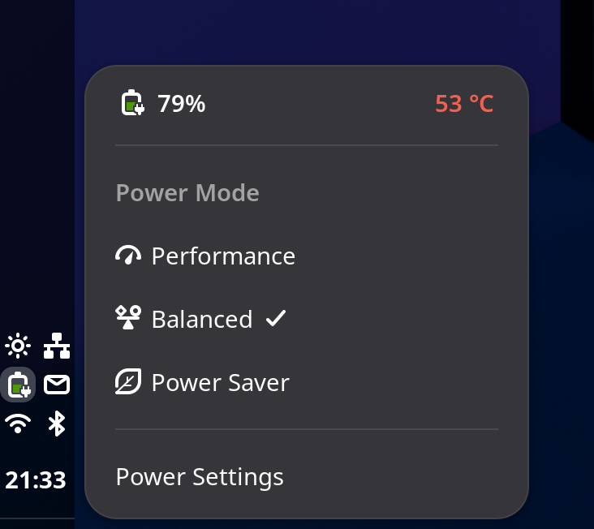
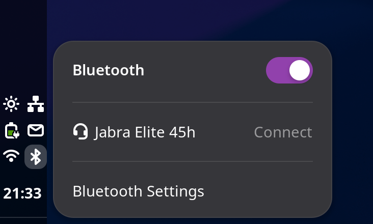
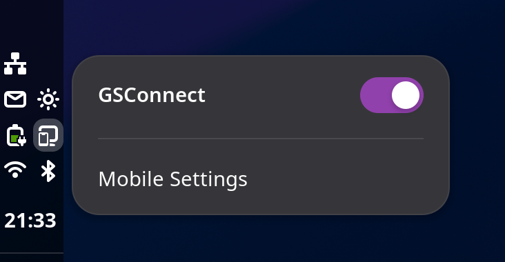
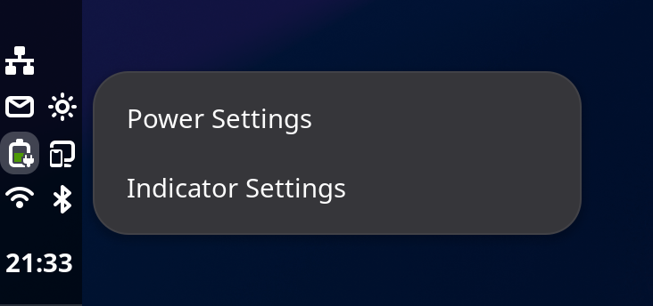
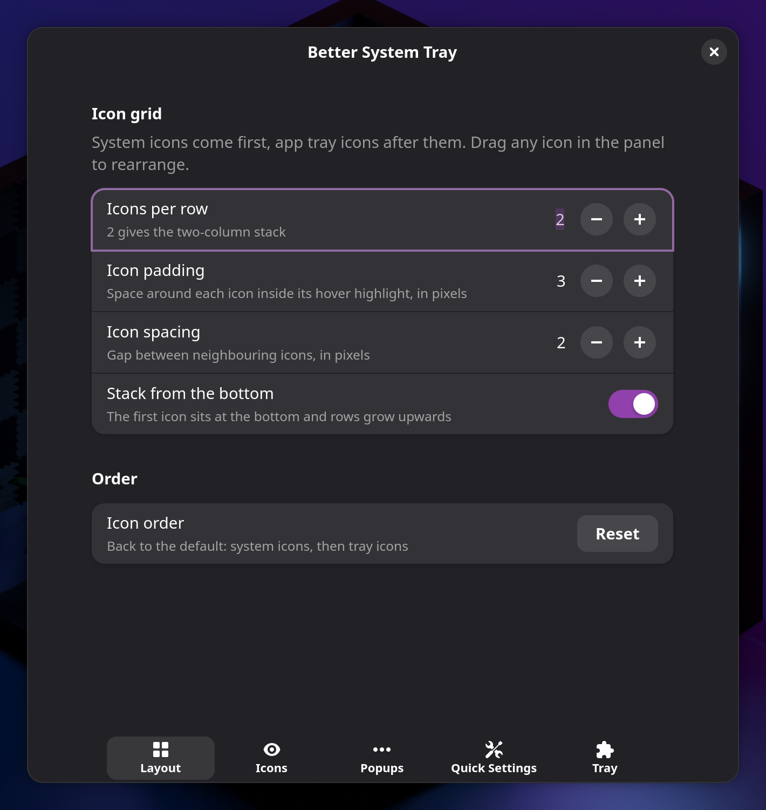
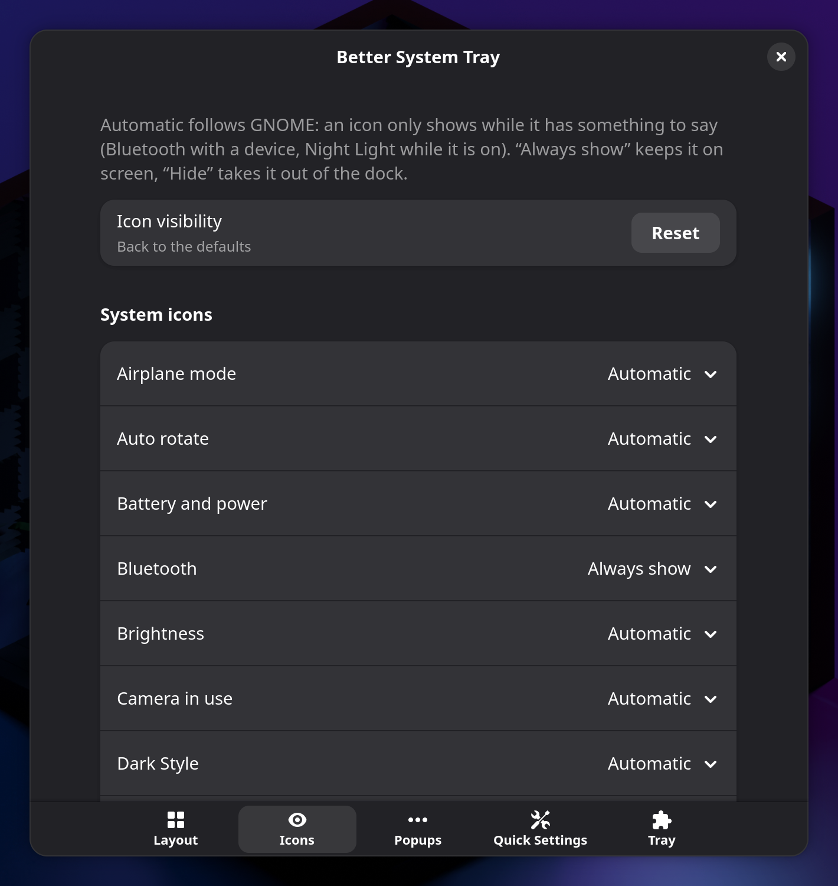
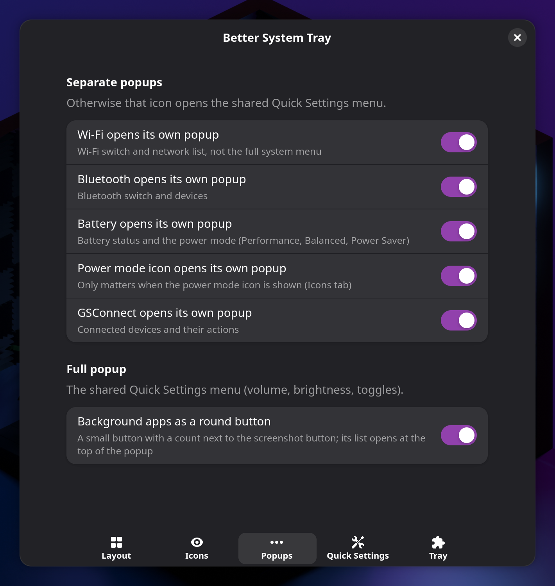
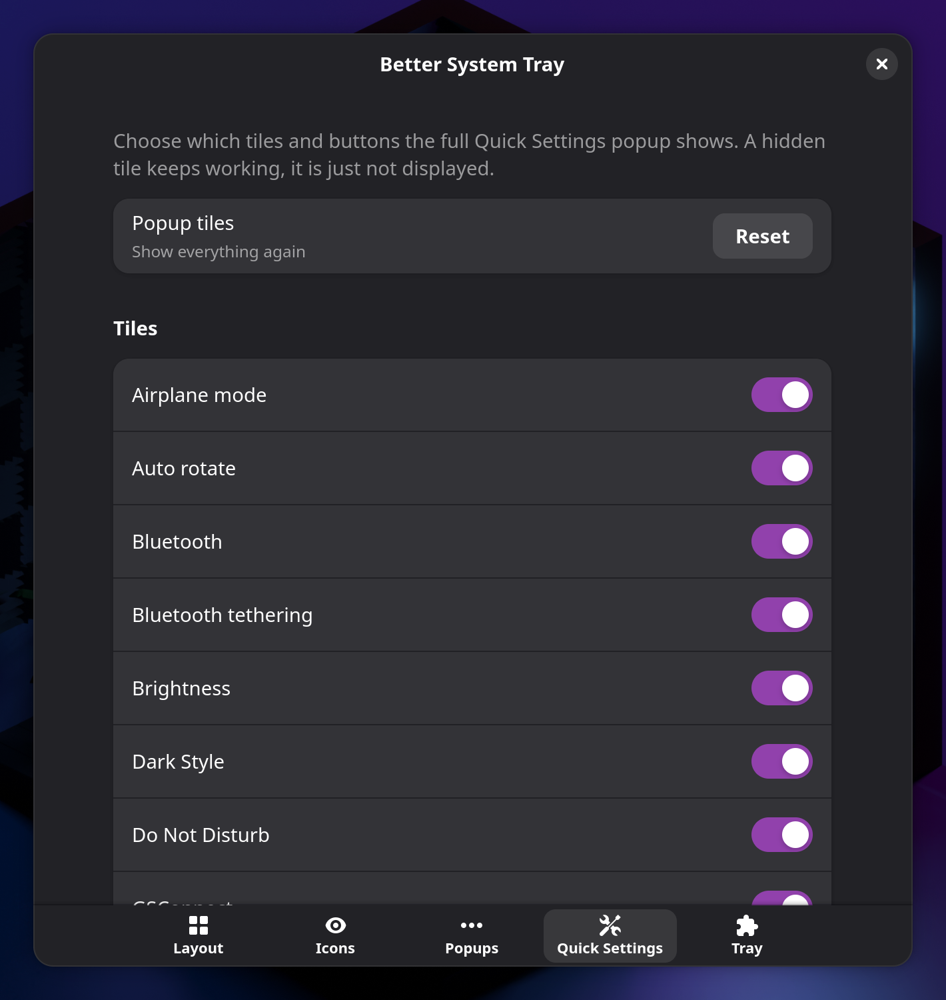
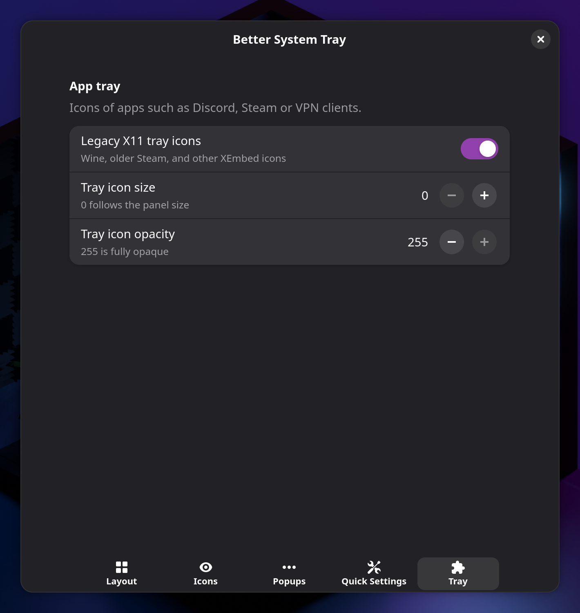

# Better System Tray

A GNOME Shell extension that replaces the cramped Quick Settings status cluster
and the AppIndicator tray with one two-column grid.

Wi-Fi, Bluetooth, battery, power mode and GSConnect each open their own popup.
Everything else still opens the shared Quick Settings menu. Icons are
drag-and-drop, stack from the bottom, and can be shown, hidden or pinned.

Requires GNOME Shell 50 or 51. Built against 50.6.

## Screenshots

Two-column tray on a vertical dock, clock on one line:


Same tray on a horizontal panel:


Battery popup — temperature stays white until the CPU is actually throttling:




Dedicated Wi-Fi, Bluetooth and GSConnect popups. Settings is always the last row:




Right-click any system icon for that panel’s settings, or the extension preferences:



Settings, five tabs:







## Install

### From a release zip

```bash
gnome-extensions install -f better-system-tray@axydavid.github.io.shell-extension.zip
```

Then log out and back in, and enable **Better System Tray** in Extensions.

It takes over the AppIndicator tray, so disable
[AppIndicator and KStatusNotifierItem Support](https://extensions.gnome.org/extension/615/appindicator-support/)
if that one is on.

### From this repo

```bash
git clone https://github.com/axydavid/better-system-tray.git
cd better-system-tray
gnome-extensions pack \
  --extra-source=backgroundApps.js \
  --extra-source=grid.js \
  --extra-source=popups.js \
  --extra-source=temperature.js \
  --extra-source=tiles.js \
  --extra-source=tray \
  -f
gnome-extensions install -f better-system-tray@axydavid.github.io.shell-extension.zip
```

Log out and back in, then enable the extension.

A development copy can also be symlinked into
`~/.local/share/gnome-shell/extensions/better-system-tray@axydavid.github.io`.
On Wayland, code changes only load after a log out.

## What you get

- **Separate popups** for Wi-Fi, Bluetooth, battery, power mode and GSConnect.
  Each one has a semibold title (with a switch where it belongs) and a settings
  row at the bottom.
- **Battery popup** with percentage and CPU temperature as two buttons.
  Temperature turns red only while the processor is actually throttling.
- **Right-click** any system icon for that panel’s settings, or the extension’s
  own preferences.
- **App tray** (StatusNotifier / AppIndicator) in the same grid, above the
  system icons.
- **Settings** for layout, which icons to show, which popups to split, which
  Quick Settings tiles to keep, and tray behaviour.

## Credits

The `tray/` tree is based on
[AppIndicator and KStatusNotifierItem Support](https://github.com/ubuntu/gnome-shell-extension-appindicator),
GPL-2.0-or-later.

## License

[GNU General Public License v2.0 or later](LICENSE).
